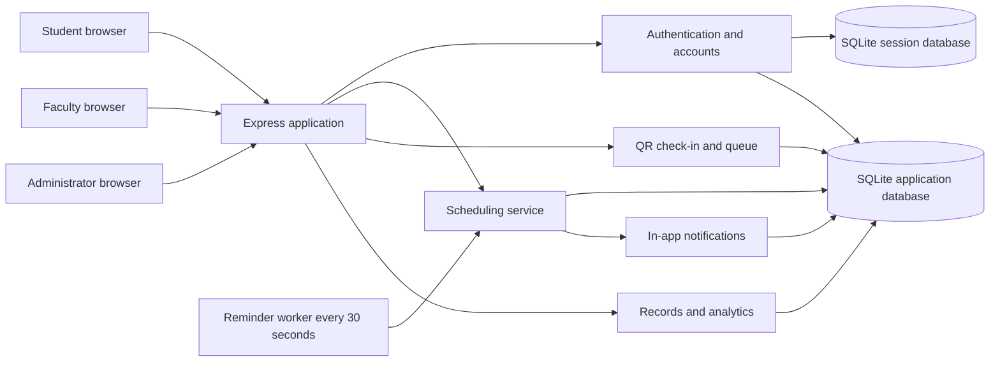
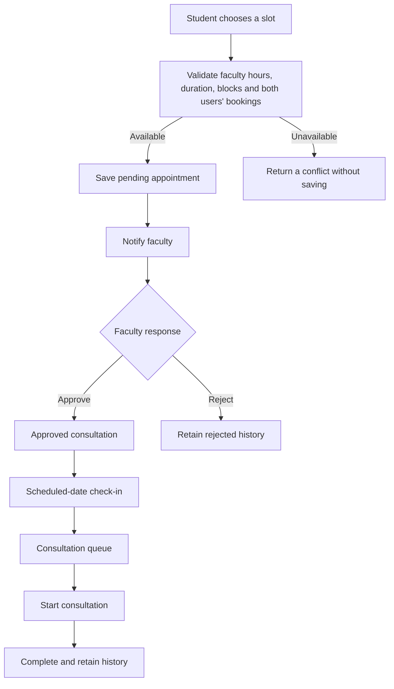
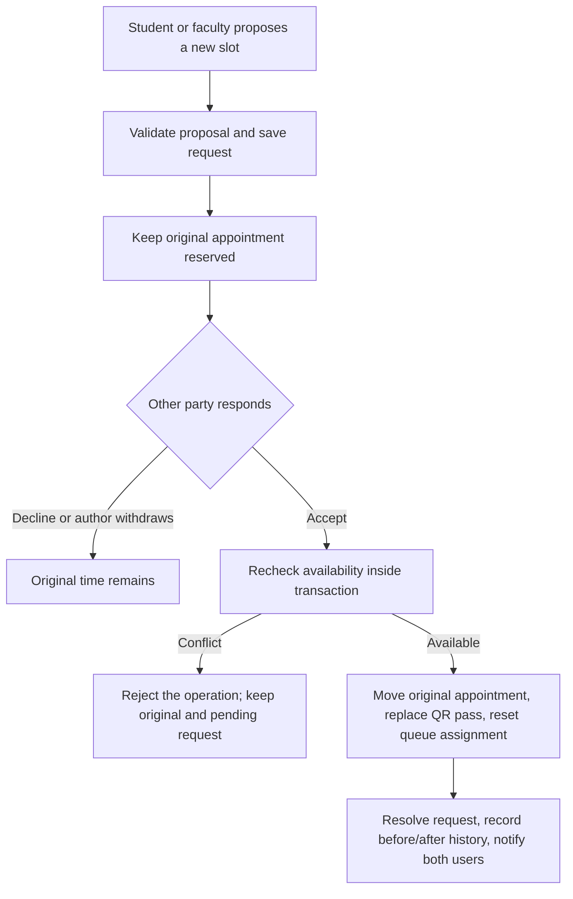
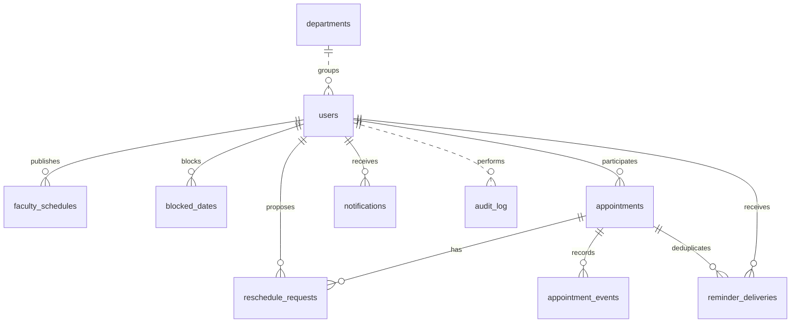

# System Design and Data Dictionary

Updated: November 25, 2026. This describes the implemented local application. Hosting beyond localhost remains a deployment task.

## Context and architecture

The browser loads static HTML/CSS/JavaScript from Express and calls same-origin JSON APIs. Sessions use HttpOnly, SameSite=Lax cookies and a persistent SQLite store. Authorization checks the current user and active status on every protected request. Scheduling mutations use immediate SQLite transactions so availability checks and writes are serialized. The application database uses WAL and foreign-key enforcement. Queue screens poll every eight seconds; notification counts poll every 30 seconds.

## Main data flows

## Entity relationships

Appointments have two separate foreign keys to users: `student_id` and `faculty_id`. Department membership currently uses the department name; the dotted department relationship is logical rather than a database foreign key. Audit actor references are retained as history. Sessions are in a separate database.

## Data dictionary

| Table | Main fields | Purpose and rules |
|---|---|---|
| users | id, email, password, name, role, student_id, faculty_id, department, course, specialization, avatar, is_active, created_at | Roles are student/faculty/admin. Passwords are bcrypt hashes. Student/faculty accounts can use their ID without email. Duplicate IDs are prevented. Deactivation preserves records. |
| departments | id, name | Case-insensitive unique names. Removal requires no assigned users; renaming updates membership names. |
| faculty_schedules | id, faculty_id, day_of_week, start_time, end_time, is_available, slot_duration, specific_date | Weekly or date-specific hours. Slot duration is 15, 30, 45 or 60 minutes. Start/end use HH:MM. Windows cannot overlap. |
| blocked_dates | id, faculty_id, date, reason, start_time, end_time | Null start/end means all day; otherwise only the interval is blocked. Overlapping blocks and conflicts with active appointments are rejected. |
| appointments | id, student_id, faculty_id, date, time_slot, end_time, purpose, remarks, status, faculty_remarks, cancel_reason, checkin_code, checkin_time, queue_number, queue_status, created_at, updated_at | Current consultation record. Status is pending, approved, rejected, cancelled, checked-in, completed or no-show. Time ranges are compared as intervals. |
| reschedule_requests | id, appointment_id, requested_by, original_date/start/end, proposed_date/start/end, reason, status, response_note, created_at, responded_at | One pending request per appointment. Status: pending, approved, rejected, withdrawn or superseded. Approval requires the other party and a fresh availability check. |
| appointment_events | id, appointment_id, actor_id, action, details, created_at | Append-only application history of booking, status, rescheduling, check-in and queue actions. Details are JSON, including before/after times for accepted changes. Legacy records have history from this version onward. |
| notifications | id, user_id, title, message, type, related_id, is_read, created_at | In-app updates and reminders. Notification content is escaped in the interface. |
| reminder_deliveries | id, appointment_id, scheduled_for, lead_minutes, user_id, sent_at | Unique appointment/time/lead/recipient key prevents repeated reminders. Leads are 1440 or 30 minutes. A rescheduled time uses a new key. |
| audit_log | id, actor_id, action, target_id, details, created_at | Administrator account/department changes and registration history. Password values are never recorded. |
| sessions (separate database) | sid, data, expires | Persistent expiring login sessions. Password resets/deactivation revoke affected sessions. |

## State and safety rules

- Pending appointments can be approved, rejected, or cancelled. Approved appointments can be checked in, cancelled, or marked missed after their end. Checked-in appointments can be served/completed or cancelled by the assigned faculty with a reason. Terminal statuses cannot be reopened.
- Student/faculty access is scoped to their own records. Administrators monitor school-wide records and manage accounts; they do not decide appointment requests or check students in.
- Availability is half-open: an appointment ending at 11:00 does not overlap another starting at 11:00. Any overlap with a block invalidates a slot.
- Availability edits/deletions and blocks list affected active appointments and reject the change until those appointments are resolved. There is no silent cancellation.
- Proposed reschedule slots are not reservations. The original booking remains reserved until acceptance. Acceptance rotates the QR code and clears the prior queue assignment.
- All school dates use Asia/Manila. Reminders skip past, cancelled, rejected, completed and inactive-user appointments. They are in-app alerts, processed while the server runs.

## Arrival confirmation and portal header

`checkin.js` owns faculty-only review and confirmation. Review is read-only; confirmation revalidates ownership, active student, approval, Philippine date and time inside an immediate SQLite transaction. The opening boundary is 15 minutes before start. Arrival after the appointment end requires an assigned-faculty reason, saved in appointment history. Duplicate confirmation returns the existing arrival without changing its timestamp or adding events. QR contents contain only an opaque random reference; student-number lookup is an equivalent manual path. Approved or checked-in passes are fetched fresh and marked no-store. Queue ordering uses scheduled start time and record ID within lifecycle states; queue numbers identify entries rather than arrival priority.

The portal header exposes page context, Philippine date, profile access and a notification preview. Notification selection marks the owned item read and opens the Notifications page. The sidebar uses a saved desktop collapse preference and a mobile overlay/close control; closed sidebar controls are inert.
## Hosted storage adaptation

The server now starts asynchronously through `require('./server').ready`. `storage.js` supplies asynchronous prepared queries and transactions for local SQLite and hosted PostgreSQL; DATABASE_URL selects PostgreSQL. Local migrations remain in `sqlite-schema.js`, `accounts.js` and `scheduling.js`; `deploy/postgres-schema.sql` creates the hosted schema. The app retains Philippine date/time strings and existing account/appointment identifiers during migration.

PostgreSQL transactions use a shared advisory transaction lock for booking, availability, arrival and queue mutations; responses are released after commit. Local SQLite transactions retain their connection lock across asynchronous work. PostgreSQL stores sessions alongside application records, so Render restarts do not discard login state. Administrator PostgreSQL snapshots are compressed, exclude sessions and secrets, and retain three downloadable copies in `portal_backups`. Off-host copies are needed for independent recovery. The tested import refuses nonempty targets; explicit offline restore replaces records transactionally and invalidates sessions.

